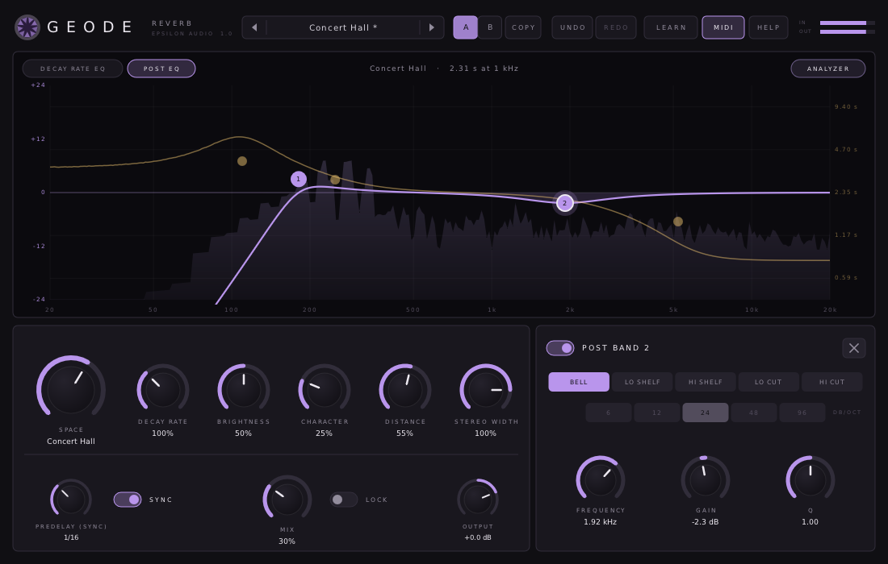
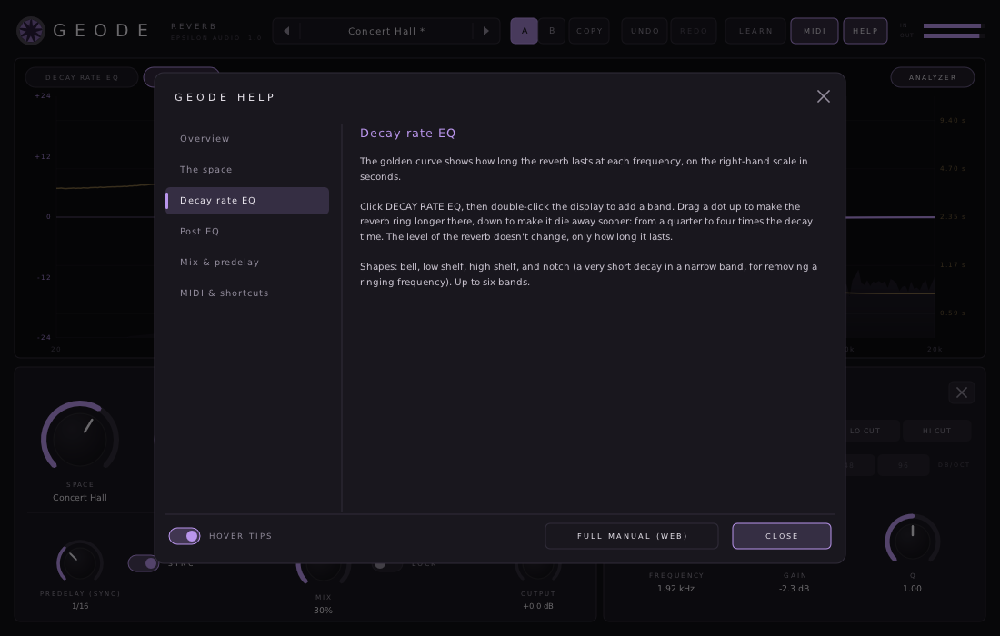

# Geode

**An algorithmic reverb with a stepless space control, a decay rate EQ and a post EQ, for macOS, Windows and Linux (VST3 · AU · CLAP · VST2).**

Part of **[Epsilon Audio](https://github.com/natehouk/epsilon-plugins)**, a family of free, open-source plugins: Monolith, Caldera, Obsidian, Strata, Basalt, Gneiss, Mica, Flint, Granite, Magma, Schist, Slate, Talc, Geode and Malachite.



Geode is a clean-room design with the feature set of FabFilter Pro-R, FabFilter's fourteenth plugin (November 2016). It was written from scratch, working only from FabFilter's public release announcement and contemporary news coverage. No FabFilter code, binaries, presets, artwork or trademarks were used.

It is part of a family of plugins:
- [Monolith](https://github.com/natehouk/monolith) (synth)
- [Caldera](https://github.com/natehouk/caldera) (filter)
- [Obsidian](https://github.com/natehouk/obsidian) (polysynth)
- [Strata](https://github.com/natehouk/strata) (tape delay)
- [Basalt](https://github.com/natehouk/basalt) (live dual filter)
- [Gneiss](https://github.com/natehouk/gneiss) (compressor)
- [Mica](https://github.com/natehouk/mica) (equalizer)
- [Flint](https://github.com/natehouk/flint) (small filter)
- [Granite](https://github.com/natehouk/granite) (limiter)
- [Magma](https://github.com/natehouk/magma) (multiband distortion)
- [Schist](https://github.com/natehouk/schist) (multiband dynamics)
- [Slate](https://github.com/natehouk/slate) (gate / expander)
- [Talc](https://github.com/natehouk/talc) (de-esser)
- **Geode**, a hollow stone lined with crystals: a resonant space

## Download

Get the latest build from [**Releases**](../../releases):

| Platform | File | Contains |
|---|---|---|
| macOS 10.13+ (Apple Silicon + Intel) | `Geode-macos-universal.zip` | VST3, AU, CLAP, manual |
| Windows x64 | `Geode-windows-x64.zip` | VST3, CLAP, VST2, manual |
| Linux x64 | `Geode-linux-x64.zip` | VST3, CLAP, VST2, manual |

### Install

| Platform | Copy | To |
|---|---|---|
| macOS | `Geode.vst3` / `Geode.component` / `Geode.clap` | `~/Library/Audio/Plug-Ins/VST3` / `Components` / `CLAP` |
| Windows | `Geode.vst3` (folder) / `Geode.clap` | `C:\Program Files\Common Files\VST3\` / `CLAP\` |
| Linux | `Geode.vst3` / `Geode.clap` | `~/.vst3/` / `~/.clap/` |

**macOS:** builds are notarized once the project's Apple signing credentials are set up. Until then they are ad-hoc signed; after copying, run:

```
xattr -dr com.apple.quarantine ~/Library/Audio/Plug-Ins/*/Geode*
```

## Features

**The space**
- **Space:** a stepless control that morphs between fourteen room models, from Small Ambience to Vast Cathedral, without clicks. The decay time follows.
- **Decay Rate** scales the decay time of the space from 50% to 200%.
- **Brightness** sets the tone, and how fast the highs die away.
- **Character** goes from a clean decay, through lively reflections and echoes, to an over-modulated, chorus-like tail.
- **Distance** moves the source from close (strong early reflections) to far (soft reflections, air, a later tail).
- **Stereo Width** from mono through stereo to extra wide (120%).

**EQ**
- **Decay rate EQ:** six bands (bell, shelves, notch) that set how long the reverb lasts at each frequency, from a quarter to four times the decay time, without changing its level.
- **Post EQ:** six bands (bell, shelves, low and high cut up to 96 dB/oct) that shape the reverb only.

**Mix and workflow**
- Mix with **mix lock** for browsing presets on a send, output level.
- Predelay 0-500 ms, or **tempo-synced** (1/64 to 1/2, straight, dotted and triplet).
- **Interactive display** showing:
  - the real decay time at each frequency (golden curve, in seconds)
  - the post EQ (violet curve)
  - a live spectrum of the reverb
- Zero latency.
- A/B with copy, undo/redo for every edit, MIDI Learn.
- Smoothed, sample-accurate automation.
- Resizable interface.
- **35 factory presets** in five categories, plus user presets.
- **Hover tips** everywhere, a **HELP window**, and a **[full manual](docs/MANUAL.md)** (also in every release zip as `Geode-Manual.html`).



### Compared with FabFilter Pro-R (2016)

| Pro-R | Geode |
|---|---|
| Space: stepless control fading between over a dozen room models, with a matching decay time | ✓ fourteen models, from Small Ambience to Vast Cathedral |
| Decay Rate 50-200% | ✓ |
| Brightness, Character (clean to lively to chorus-like), Distance, Stereo Width (mono to beyond stereo) | ✓ |
| Mix | ✓ with mix lock |
| Predelay 0-500 ms with optional tempo sync | ✓ |
| Decay Rate EQ: six bands with low/high shelf, bell and notch | ✓ |
| Post EQ: six bands with low/high cut (up to 96 dB/oct), low/high shelf and bell | ✓ |
| Real-time spectrum analyzer that also shows decay time at each frequency | ✓ |
| Large interactive display; full-screen mode; medium, large and extra-large sizes | Freely resizable interface |
| MIDI Learn, undo/redo, A/B, smooth parameter changes, help with interactive hints | ✓ hover tips, help pages and full manual |
| Factory presets | 35 factory presets plus user presets |
| Pro Tools (RTAS/AAX/AudioSuite) | Not supported (needs Avid's SDK and signing) |

## Build from source

The plugin is built on [DPF](https://github.com/DISTRHO/DPF):

```
git clone --recursive https://github.com/DISTRHO/DPF.git dpf
make -C plugins/Geode                    # Linux / macOS (macOS also builds the AU)
make -C plugins/Geode WINDOWS=true CC=x86_64-w64-mingw32-gcc CXX=x86_64-w64-mingw32-g++
```

GitHub Actions builds all three platforms on every push. The macOS build is universal. It is signed and notarized when the Developer ID secrets are set (`MACOS_CERT_P12`, `MACOS_CERT_PASSWORD`, `NOTARY_KEY`, `NOTARY_KEY_ID`, `NOTARY_ISSUER`), and ad-hoc signed otherwise. A `v*` tag, or a release published on GitHub, attaches the zips to that release.

## Tests

```
cd tests
g++ -O2 -std=c++11 features.cpp -o features && ./features   # dry/wet, RT60 against the displayed decay time, decay rate, decay EQ bands and notch,
                                                            # brightness, predelay (ms and synced), width, post EQ, level across spaces,
                                                            # stability at extreme settings, click-free space sweeps, presets
g++ -O2 -std=c++11 fuzz.cpp -o fuzz && ./fuzz               # random parameters and automation at 44.1-192 kHz: always finite
g++ -O2 -std=c++11 presets.cpp -o presets && ./presets      # a noise burst through every preset: level, peak and tail
g++ -O3 -std=c++11 bench.cpp -o bench && ./bench            # CPU
```

Geode takes about 3% of one CPU core (4% with all twelve EQ bands in use).

Release checks:
- Steinberg's VST3 validator passes 47/47.
- The interface is exercised with scripted input and a live test mix: presets, adding and dragging bands on both EQs, the space knob, sync, tips and help.

## Source layout

| File | Contents |
|---|---|
| `plugins/Geode/GeodeEngine.hpp` | All DSP: room models, predelay, early reflections, diffusion, the 16-line feedback delay network and its decay filters, width, tone, post EQ. Header-only |
| `plugins/Geode/ParamDefs.hpp` | Parameter table, labels, value mapping |
| `plugins/Geode/Presets.hpp` | Factory presets |
| `plugins/Geode/UserPresets.hpp` | User preset files |
| `plugins/Geode/Help.hpp` | Hover tip text and in-plugin help pages |
| `plugins/Geode/Fft.hpp` | FFT for the analyzer |
| `plugins/Geode/GeodePlugin.hpp/.cpp` | Plugin wrapper: parameters, tempo, MIDI Learn |
| `plugins/Geode/GeodeUI.cpp` | Custom vector interface (NanoVG) |
| `docs/MANUAL.md` | User manual (`Geode-Manual.html` is generated from it with pandoc) |

## License

[MIT](LICENSE). Built with [DPF](https://github.com/DISTRHO/DPF) and its bundled NanoVG, which are under the ISC license. `plugins/Geode/ResizeHandle.hpp` comes from DPF's examples and keeps its ISC notice.

"FabFilter" and "FabFilter Pro-R" are trademarks of FabFilter Software Instruments. Geode is not affiliated with or endorsed by FabFilter.
